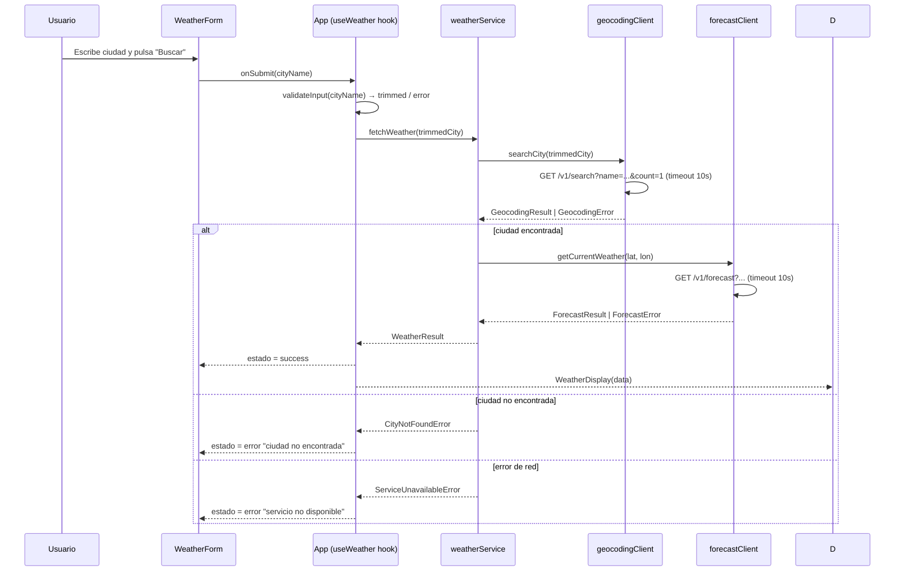

# Design Document

## Overview

La Weather Forecast App es una Single Page Application (SPA) que permite al usuario introducir el nombre de una ciudad y obtener las condiciones meteorológicas actuales (temperatura, humedad relativa y precipitaciones). La aplicación orquesta dos servicios externos de Open-Meteo sin necesidad de clave de API:

1. **Geocoding API** (`https://geocoding-api.open-meteo.com/v1/search`) — convierte el nombre de ciudad en coordenadas geográficas (latitud/longitud).
2. **Forecast API** (`https://api.open-meteo.com/v1/forecast`) — devuelve el clima actual para unas coordenadas dadas.

**Stack tecnológico:** React 18 + TypeScript, con Vite como bundler. Se escoge React porque:
- Facilita la gestión declarativa del estado de UI (loading, error, resultado).
- El ecosistema de testing (Vitest + fast-check para PBT) está bien integrado con Vite.
- Es ampliamente conocido y compatible con los requisitos de accesibilidad (soporte ARIA nativo en JSX).

No se introduce ningún framework de estado global (Redux, Zustand) porque la complejidad del estado cabe en un único componente raíz con hooks de React.

**Resumen de datos:**
- Endpoint de pronóstico: `GET /v1/forecast?latitude={lat}&longitude={lon}&current=temperature_2m,relative_humidity_2m,precipitation`
- Respuesta `current`: `{ temperature_2m: number, relative_humidity_2m: number, precipitation: number }`
- Endpoint geocoding: `GET /v1/search?name={city}&count=1&language=es`
- Respuesta: `{ results: [{ name, latitude, longitude, country, … }] }`

---

## Architecture

La aplicación sigue una arquitectura de **tres capas** dentro del cliente:

```
┌─────────────────────────────────────────────────┐
│                   UI Layer                      │
│  App (root) → WeatherForm + WeatherDisplay      │
│  Gestiona eventos de usuario y renderiza estado │
└──────────────────┬──────────────────────────────┘
                   │ llama a
┌──────────────────▼──────────────────────────────┐
│             Business Logic Layer                │
│  weatherService.ts                              │
│  Orquesta geocoding → forecast, valida, mapea   │
└──────────────────┬──────────────────────────────┘
                   │ llama a
┌──────────────────▼──────────────────────────────┐
│               Data / API Layer                  │
│  geocodingClient.ts + forecastClient.ts         │
│  HTTP puro, timeout, manejo de errores HTTP     │
└─────────────────────────────────────────────────┘
```

### Flujo de datos principal



---

## Components and Interfaces

### Árbol de componentes

```
App
├── WeatherForm
│   ├── <label> + <input> (City_Input)
│   ├── <button> submit
│   └── LoadingSpinner (condicional)
├── ErrorMessage (condicional)
└── WeatherDisplay (condicional)
    ├── CityHeading
    ├── TemperatureCard
    ├── HumidityCard
    └── PrecipitationCard
```

### Interfaces TypeScript

```typescript
// --- Modelos de dominio ---

/** Coordenadas geográficas WGS84 */
interface Coordinates {
  latitude: number;   // -90.0 a 90.0
  longitude: number;  // -180.0 a 180.0
}

/** Resultado de la geocodificación */
interface GeocodingResult {
  name: string;
  country: string;
  coordinates: Coordinates;
}

/** Valores meteorológicos actuales (ya mapeados) */
interface WeatherData {
  cityName: string;
  country: string;
  temperatureCelsius: number;     // valor crudo de la API
  relativeHumidityPercent: number;
  precipitationMm: number;
}

// --- Errores de dominio ---

type WeatherError =
  | { kind: 'CITY_NOT_FOUND'; cityName: string }
  | { kind: 'GEOCODING_SERVICE_UNAVAILABLE' }
  | { kind: 'FORECAST_SERVICE_UNAVAILABLE' }
  | { kind: 'INVALID_INPUT'; reason: 'EMPTY' | 'TOO_LONG' };

// --- Estado de la aplicación ---

type AppStatus = 'idle' | 'loading' | 'success' | 'error';

interface AppState {
  status: AppStatus;
  lastQuery: string;
  weatherData: WeatherData | null;
  error: WeatherError | null;
}
```

### Props de los componentes principales

```typescript
interface WeatherFormProps {
  onSubmit: (cityName: string) => void;
  isLoading: boolean;
  defaultValue: string;
}

interface ErrorMessageProps {
  error: WeatherError;
}

interface WeatherDisplayProps {
  data: WeatherData;
}
```

### API interna del servicio

```typescript
// weatherService.ts
async function fetchWeather(cityName: string): Promise<WeatherData>
// Lanza WeatherError (discriminated union) en caso de fallo

// geocodingClient.ts
async function searchCity(name: string): Promise<GeocodingResult>
// Lanza GeocodingError en caso de fallo / ciudad no encontrada

// forecastClient.ts
async function getCurrentWeather(coords: Coordinates): Promise<RawForecastData>
// Lanza ForecastError en caso de fallo / timeout
```

### inputValidator.ts

```typescript
function validateCityInput(raw: string): { valid: true; trimmed: string } | { valid: false; error: WeatherError }
```

---

## Data Models

### Respuesta cruda de la Geocoding API

```typescript
interface GeocodingApiResponse {
  results?: Array<{
    id: number;
    name: string;
    latitude: number;
    longitude: number;
    country: string;
    country_code: string;
    admin1?: string;
  }>;
}
```

> Si `results` está ausente o es un array vacío, se interpreta como ciudad no encontrada.

### Respuesta cruda de la Forecast API

```typescript
interface ForecastApiResponse {
  latitude: number;
  longitude: number;
  timezone: string;
  current: {
    time: string;
    temperature_2m: number;
    relative_humidity_2m: number;
    precipitation: number;
  };
  current_units: {
    temperature_2m: string;   // "°C"
    relative_humidity_2m: string; // "%"
    precipitation: string;    // "mm"
  };
}
```

> Si el campo `current` o cualquiera de sus sub-campos está ausente, se trata como `FORECAST_SERVICE_UNAVAILABLE`.

### Mapeo de API a dominio

| Campo API (`current.*`)    | Campo dominio (`WeatherData.*`) | Transformación                         |
|----------------------------|---------------------------------|----------------------------------------|
| `temperature_2m`           | `temperatureCelsius`            | Almacenar tal cual; redondear al mostrar |
| `relative_humidity_2m`     | `relativeHumidityPercent`       | Almacenar tal cual; mostrar como entero |
| `precipitation`            | `precipitationMm`               | Almacenar tal cual; redondear al mostrar |

Las transformaciones de presentación (redondeo, unidades) ocurren **en la capa UI**, no en el servicio, para preservar la fidelidad de los datos en los tests de propiedades.

### Flujo de validación de la entrada

```
raw string
    │
    ▼
trim()  ──→  "" o solo espacios  ──→  Error: EMPTY
    │
    ▼
length > 100  ──────────────────────→  Error: TOO_LONG
    │
    ▼
string válida (1-100 chars)
```

---

## Correctness Properties

*A property is a characteristic or behavior that should hold true across all valid executions of a system — essentially, a formal statement about what the system should do. Properties serve as the bridge between human-readable specifications and machine-verifiable correctness guarantees.*

### Property 1: Whitespace inputs are always invalid

*For any* string composed entirely of whitespace characters (spaces, tabs, newlines), `validateCityInput` SHALL return an invalid result with reason `EMPTY`, and the list of pending API calls SHALL remain empty.

**Validates: Requirements 1.3, 1.4**

---

### Property 2: Valid trimmed inputs are accepted

*For any* non-whitespace string of length between 1 and 100 characters (after trimming), `validateCityInput` SHALL return a valid result whose `trimmed` value equals the input with leading/trailing whitespace removed.

**Validates: Requirements 1.5, 1.7**

---

### Property 3: Inputs exceeding 100 characters are always rejected

*For any* string whose post-trim length exceeds 100 characters, `validateCityInput` SHALL return an invalid result with reason `TOO_LONG` and SHALL NOT trigger a geocoding request.

**Validates: Requirements 1.6, 2.6**

---

### Property 4: Geocoding result extraction preserves valid coordinates

*For any* Geocoding API response that contains at least one result entry with `latitude ∈ [-90, 90]` and `longitude ∈ [-180, 180]`, `parseGeocodingResponse` SHALL return a `GeocodingResult` whose `coordinates.latitude` and `coordinates.longitude` equal the values from the first entry.

**Validates: Requirements 2.2**

---

### Property 5: Weather data mapping round-trip preserves numeric values

*For any* valid `ForecastApiResponse` object where `current.temperature_2m`, `current.relative_humidity_2m`, and `current.precipitation` are finite numbers, `mapForecastToWeatherData` SHALL produce a `WeatherData` where those values are preserved exactly (no loss of precision in storage), and the display functions SHALL produce strings that represent values rounded to the specified number of decimal places.

**Validates: Requirements 4.2, 4.3, 4.4**

---

### Property 6: Missing forecast fields produce a service error

*For any* `ForecastApiResponse` object where one or more of `current.temperature_2m`, `current.relative_humidity_2m`, or `current.precipitation` is absent or `undefined`, `mapForecastToWeatherData` SHALL throw/return a `FORECAST_SERVICE_UNAVAILABLE` error and SHALL NOT produce a partial `WeatherData` object.

**Validates: Requirements 3.3, 4.6**

---

### Property 7: At most one error message is shown at a time

*For any* sequence of app state transitions (idle → loading → error → loading → success → …), the rendered output SHALL contain at most one element with the ARIA role `alert` at any point in time.

**Validates: Requirements 5.3**

---

### Property 8: Temperature display rounding

*For any* finite number `t`, `formatTemperature(t)` SHALL return a string representation of `t` rounded to exactly one decimal place followed by " °C", consistent with `Number(t).toFixed(1)`.

**Validates: Requirements 4.2**

---

### Property 9: Precipitation display rounding

*For any* finite non-negative number `p`, `formatPrecipitation(p)` SHALL return a string representation of `p` rounded to exactly one decimal place followed by " mm".

**Validates: Requirements 4.4**

---

## Error Handling

### Jerarquía de errores

Todos los errores de la aplicación se modelan como una **discriminated union** (`WeatherError`) para que TypeScript exija el manejo exhaustivo en cada punto de uso.

| Código de error                  | Causa                                                         | Mensaje mostrado al usuario                          |
|----------------------------------|---------------------------------------------------------------|------------------------------------------------------|
| `INVALID_INPUT / EMPTY`          | Ciudad vacía o solo espacios                                  | "Por favor, introduce el nombre de una ciudad."      |
| `INVALID_INPUT / TOO_LONG`       | Nombre > 100 caracteres tras trim                            | "El nombre de la ciudad es demasiado largo (máx. 100 caracteres)." |
| `CITY_NOT_FOUND`                 | Geocoding API devuelve 0 resultados                          | "No se ha encontrado la ciudad «{cityName}»."        |
| `GEOCODING_SERVICE_UNAVAILABLE`  | Error de red o HTTP 4xx/5xx en Geocoding API                 | "El servicio de localización no está disponible. Inténtalo de nuevo." |
| `FORECAST_SERVICE_UNAVAILABLE`   | Error de red, timeout, HTTP 4xx/5xx o campos ausentes        | "El servicio meteorológico no está disponible. Inténtalo de nuevo." |

### Política de timeout

Ambas llamadas HTTP se implementan usando `AbortController` + `setTimeout` con 10 segundos. Si el controlador aborta la señal, el `fetch` rechaza con `AbortError`, que se captura y reemplaza por el error de dominio correspondiente.

```typescript
async function fetchWithTimeout(url: string, timeoutMs = 10_000): Promise<Response> {
  const controller = new AbortController();
  const timer = setTimeout(() => controller.abort(), timeoutMs);
  try {
    const response = await fetch(url, { signal: controller.signal });
    return response;
  } finally {
    clearTimeout(timer);
  }
}
```

### Invariantes de estado de error

- Cuando `status === 'error'`, `error` nunca es `null` y `weatherData` siempre es `null`.
- Cuando `status === 'success'`, `weatherData` nunca es `null` y `error` siempre es `null`.
- Cuando `status === 'loading'`, el botón submit está deshabilitado.
- Cuando hay un `Error_Message` visible, `City_Input` permanece editable y pre-rellenado con la última consulta.

---

## Testing Strategy

### Enfoque dual (unit + property-based)

| Tipo de test         | Herramienta          | Objetivo                                                                        |
|----------------------|----------------------|---------------------------------------------------------------------------------|
| Unit tests           | Vitest               | Comportamientos específicos, casos de borde, integración entre capas            |
| Property-based tests | Vitest + fast-check  | Propiedades universales sobre validación, mapeo de datos y formato de pantalla  |
| Component tests      | Vitest + @testing-library/react | Renderizado y accesibilidad de componentes React                   |
| Integration tests    | Vitest + MSW (Mock Service Worker) | Flujo completo con APIs simuladas (1-3 ejemplos representativos) |

### Tests de propiedades (fast-check)

Se elige **fast-check** como librería PBT porque está diseñada para JavaScript/TypeScript, se integra nativamente con Vitest, y genera arbitrarios ricos para strings, números y objetos.

Cada test de propiedad se ejecuta con **mínimo 100 iteraciones** y lleva un comentario de trazabilidad:

```typescript
// Feature: weather-forecast-app, Property 1: whitespace inputs are always invalid
it.prop([fc.string().filter(s => s.trim() === '')])(
  'validates whitespace strings as EMPTY',
  (input) => {
    const result = validateCityInput(input);
    expect(result.valid).toBe(false);
    if (!result.valid) expect(result.error.reason).toBe('EMPTY');
  }
);
```

### Cobertura por propiedad

| Propiedad | Módulo a testear           | Arbitrario fast-check principal                              |
|-----------|----------------------------|--------------------------------------------------------------|
| P1        | `inputValidator`           | `fc.string()` filtrado para solo-whitespace                  |
| P2        | `inputValidator`           | `fc.string()` con 1-100 chars no-whitespace                  |
| P3        | `inputValidator`           | `fc.string({ minLength: 101 })` (post-trim)                  |
| P4        | `geocodingClient` (parser) | `fc.record` con latitude/longitude en rangos válidos         |
| P5        | `forecastClient` (mapper)  | `fc.record` con números finitos para los tres campos         |
| P6        | `forecastClient` (mapper)  | `fc.record` con al menos un campo omitido                    |
| P7        | `App` component            | `fc.array` de eventos de usuario (búsqueda, éxito, error)    |
| P8        | `formatTemperature`        | `fc.float({ noNaN: true, noDefaultInfinity: true })`         |
| P9        | `formatPrecipitation`      | `fc.float({ min: 0, noNaN: true, noDefaultInfinity: true })` |

### Tests de integración (MSW)

Se simulan con MSW los dos endpoints de Open-Meteo para cubrir:

1. Flujo feliz: ciudad válida → pronóstico mostrado.
2. Ciudad no encontrada: Geocoding API devuelve `{}` (sin `results`).
3. Error de servicio: Forecast API devuelve HTTP 503.

### Tests de accesibilidad

- Verificar `aria-label` en `City_Input` con `getByRole('textbox', { name: /ciudad/i })`.
- Verificar que `ErrorMessage` usa `role="alert"`.
- Verificar que el spinner tiene texto alternativo con `aria-live="polite"`.
- Verificar navegación por teclado con `userEvent.tab()`.
